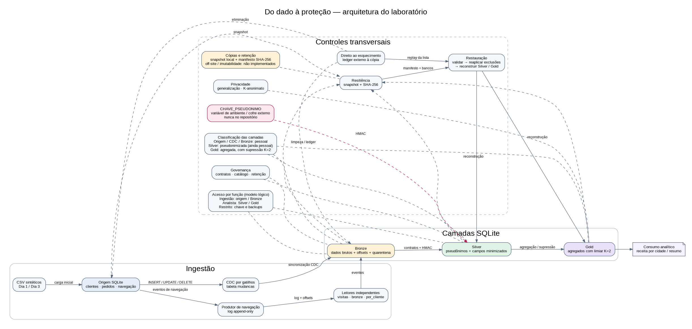
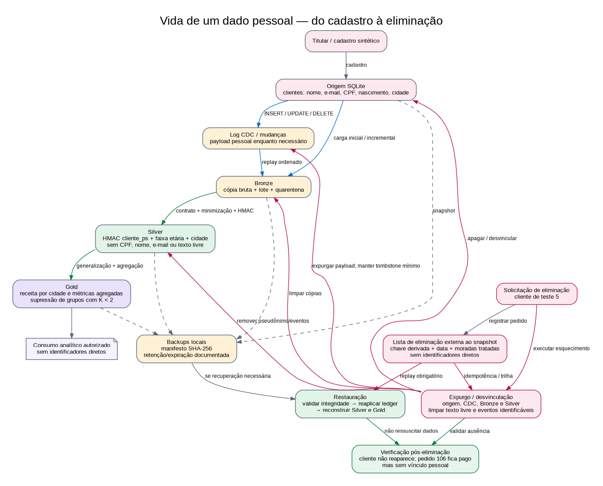

# Do dado à proteção: pipeline da loja online

Projeto do Laboratório DI (Data Ingestion & Protection).

## Grupo

- Eduardo Veiga (RM561575)
- Thiago Ulyrch (RM565929)

## Arquitetura

### Visão 1 — Estrutura do pipeline



- Fonte editável: [`arquitetura/pipeline.dot`](arquitetura/pipeline.dot).
- Versão vetorial: [`arquitetura/pipeline.svg`](arquitetura/pipeline.svg).
- O desenho distingue carga e CDC, identifica as classes das camadas, a localização da chave, o modelo lógico de acesso e as cópias/limitações de retenção.

### Visão 2 — Vida do dado pessoal



- Fonte editável: [`arquitetura/vida-do-dado.dot`](arquitetura/vida-do-dado.dot).
- Versão vetorial: [`arquitetura/vida-do-dado.svg`](arquitetura/vida-do-dado.svg).
- O fluxo mostra o percurso do cadastro até Bronze, Silver e Gold, o pedido de eliminação, o ledger e a reaplicação das eliminações após restauração.

## Escolhas

| Decisão | Escolha |
|---|---|
| Linguagem | Python 3 |
| Banco da origem | SQLite (`origem/loja.db`) |
| Camadas de destino (bronze, silver, gold) | SQLite em `camadas/` (`bronze.db`, `silver.db` e `gold.db`) |
| Onde trabalhamos | Ambiente local, sem broker ou serviços externos (Trilha A) |

## Como rodar

```bash
python ingestao/criar_origem.py        # cria a origem com os dados do dia 1
python evidencias/conferir_missao0.py  # confere os números esperados (Missão 0)

python ingestao/carga.py               # carga incremental origem -> bronze
python ingestao/aplicar_dia2.py        # aplica na origem as mudanças do dia 2
python evidencias/conferir_missao1.py  # roda o cenário completo e confere (Missão 1)

python ingestao/captura.py             # liga o log de mudanças na origem (Missão 2)
python ingestao/sincronizar.py         # aplica o log na bronze, a partir do offset salvo
python evidencias/conferir_missao2.py  # roda o cenário completo e confere (Missão 2)

python ingestao/publicar_navegacao.py             # publica os 8 eventos, um por segundo
python ingestao/leitores_navegacao.py              # processa o backlog com os três leitores
python evidencias/conferir_missao3.py              # cenário reproduzível e evidências (Missão 3)

python qualidade/validar_pedidos.py                # valida lote do dia 3, silver e quarentena (Missão 4)
python evidencias/conferir_missao4.py              # cenário reproduzível e evidências (Missão 4)

python governanca/validar_acordo.py               # regra como código para retenção (Missão 5)
python governanca/gerar_catalogo.py                # catálogo derivado dos contratos e acordo
python governanca/varrer_dados_pessoais.py         # varredura da Bronze por padrões pessoais
python evidencias/conferir_missao5.py              # cenário reproduzível e evidências (Missão 5)

# A chave abaixo é só exemplo local; em produção, usar gerenciador de segredos.
# Linux/macOS: export CHAVE_PSEUDONIMO="uma-chave-local-com-pelo-menos-16-bytes"
# PowerShell: $env:CHAVE_PSEUDONIMO="uma-chave-local-com-pelo-menos-16-bytes"
python seguranca/gerar_silver.py                   # Silver sem CPF/nome/e-mail/observação/IP (Missão 6)
python evidencias/conferir_missao6.py               # cenário reproduzível e evidências (Missão 6)
python privacidade/gerar_consumo.py                  # mede K e cria Gold agregada (Missão 7)
python evidencias/conferir_missao7.py                # cenário reproduzível e evidências (Missão 7)
python privacidade/esquecer.py 5                     # pedido de eliminação idempotente (Missão 8)
python evidencias/conferir_missao8.py                # cenário reproduzível e evidências (Missão 8)

python resiliencia/backup.py                         # snapshot SQLite + manifesto SHA-256 (Missão 9)
# Para restaurar, definir CHAVE_PSEUDONIMO e usar o diretório de snapshot gerado:
# python resiliencia/restaurar.py resiliencia/backups/<snapshot>
python evidencias/conferir_missao9.py                # testa restore, integridade e replay da eliminação (Missão 9)
```

Só usa a biblioteca padrão do Python, não há nada para instalar.

## Dados

Os dados são fictícios: os CPFs são inválidos de propósito e os IPs pertencem à
faixa 203.0.113.0/24, reservada para documentação.

## Estrutura

```
pipeline/
├── dados/          dia 1, mudanças do dia 2, lote do dia 3, sintético
├── contratos/      pedidos.yaml, clientes.yaml, navegacao.yaml
├── ingestao/       carga incremental, log, produtor e leitores
├── qualidade/      validação e quarentena
├── governanca/     acordo.yaml, catalogo.md, regras como código
├── seguranca/      matriz.md, pseudonimização, camada silver
├── privacidade/    visão de consumo, moradas.md, esquecer
├── resiliencia/    plano.md, backup.py, restaurar.py, reconstrução
├── arquitetura/    fonte e imagem do desenho
├── evidencias/     números de cada missão
├── origem/         banco da origem (não vai para o git)
├── camadas/        bronze (e depois silver e gold), não vai para o git
└── README.md       como rodar + peças da entrega
```

## Peças da entrega final

| # | Peça | Status |
|---|---|---|
| 1 | Carga incremental | feita (`ingestao/carga.py`, `evidencias/missao1.txt`) |
| 2 | Log de mudanças | feita (`ingestao/captura.py`, `ingestao/sincronizar.py`, `evidencias/missao2.txt`) |
| 3 | Fluxo com vários leitores | feita (`ingestao/publicar_navegacao.py`, `ingestao/leitores_navegacao.py`, `evidencias/missao3.txt`) |
| 4 | Contrato e quarentena | feita (`contratos/*.yaml`, `qualidade/validar_pedidos.py`, `evidencias/missao4.txt`) |
| 5 | Acordo de governança, catálogo gerado, regra como código e varredura | feita (`governanca/`, `evidencias/missao5.txt`) |
| 6 | Matriz e trajeto do CPF | feita (`seguranca/`, `evidencias/missao6.txt`) |
| 7 | Visão de consumo, generalização e K-anonimato | feita (`privacidade/gerar_consumo.py`, `evidencias/missao7.txt`) |
| 8 | Esquecimento com evidência | feita (`privacidade/esquecer.py`, `privacidade/moradas.md`, `evidencias/missao8.txt`) |
| 9 | Plano de resiliência | feita (`resiliencia/`, `evidencias/missao9.txt`) |
| 10 | Desenho e README final | feita (`arquitetura/pipeline.svg`, `arquitetura/pipeline.dot`, `evidencias/missao10.txt`) |

### Missão 8: direito de eliminação e evidência

`privacidade/esquecer.py <cliente_id>` aplica a eliminação nas bases ativas. Para o cenário do laboratório, `python privacidade/esquecer.py 5` remove o cadastro onde ainda exista, elimina os eventos de navegação do titular na origem, no log e nas camadas, limpa o texto livre e desvincula o pedido 106 sem apagar seu valor financeiro. Os agregados dos leitores são recalculados a partir dos eventos remanescentes. O pedido CDC `DELETE` permanece como tombstone mínimo (`dados=NULL`) para que a exclusão não seja perdida em uma sincronização posterior.

A lista `privacidade/lista_eliminacao.jsonl` e a tabela `bronze.lista_eliminacao` guardam apenas uma chave derivada de solicitação, timestamp e inventário de moradas; não guardam nome, e-mail, CPF, telefone ou IP. `privacidade/moradas.md` documenta as técnicas por local, inclusive a expiração de cópias e a reaplicação da lista antes de restaurar. A Gold não é recalculada durante a eliminação porque já não expõe dados identificadores; a receita total continua em R$ 844,90, e a visão por cidade permanece igual.

O verificador `python evidencias/conferir_missao8.py` reconstrói o cenário desde o dia 1, publica e consome a navegação, executa `esquecer 5` duas vezes e confere ausência dos dados de teste nos bancos ativos, 6 eventos remanescentes, 11 pedidos validados e receita preservada. Os CSVs em `dados/` são fixtures sintéticas para reconstrução do laboratório, não cópias operacionais; em ambiente real, exports, réplicas, backups e arquivos de origem também precisam estar no inventário e na política de retenção.


### Missão 7: generalização e visão de consumo

`seguranca/gerar_silver.py` substitui a data de nascimento exata por `faixa_etaria` (25–34, 35–44, 45–54), evitando que o analista veja a data completa. Os contratos documentam a finalidade dos campos pessoais que permanecem úteis. `privacidade/gerar_consumo.py` mede a cardinalidade de `cidade + faixa_etaria` e grava `camadas/gold.db`: `receita_por_cidade` só divulga contagem e receita quando há pelo menos K=2 clientes. Campinas é suprimida; Santos soma R$ 545,00 (3 clientes) e Sorocaba R$ 95,90 (2 clientes). O resumo separado mantém a receita paga total de R$ 844,90, incluindo o pedido 106, que sobreviveu à exclusão do cadastro 5 e não pode ser atribuído a uma cidade. Com K=3, Sorocaba também seria suprimida.

O verificador `python evidencias/conferir_missao7.py` recria o cenário e valida generalização, K e agregados.

## Decisões de projeto

- **Missão 1, marca-d'água:** `clientes` e `pedidos` usam o maior `atualizado_em` já
  carregado (comparação estrita, `>`) e mesclagem pela chave `id`. A marca fica na
  tabela `_estado` da bronze e só avança na mesma transação que grava os dados.
- **Missão 1, navegação:** a marca é o `evento_id`, e não o horário, porque o evento 8
  aconteceu antes do evento 7. `INSERT OR IGNORE` na chave `evento_id` é a segunda trava
  contra duplicata.
- **Limite conhecido:** a marca-d'água não enxerga exclusões. A cliente 5 some da origem e
  continua na bronze. A Missão 2 resolve isso.

### Missão 2: trilha escolhida

**Trilha A, sem infraestrutura:** tabela `mudancas` na origem, preenchida por gatilhos.

Motivo: o grupo usa SQLite, que não tem replicação lógica nem log de transações aberto
para leitura, então a Trilha B exigiria trocar de banco e subir servidor e broker só para
esta missão. Os gatilhos entregam as mesmas garantias que a missão cobra: ordem
(`seq` crescente, sem reaproveitamento), captura de exclusões, offset como único estado
do consumidor e reaplicação sem efeito colateral. O custo é que o gatilho só vê mudanças
feitas pelo SQL da própria origem, e não o log interno do banco, e que cada escrita paga
uma gravação a mais.

- **Foto + log:** a captura foi ligada depois da carga do dia 1. A carga da Missão 1
  serve de foto inicial e o log carrega tudo que veio depois, como em um CDC real.
  Um destino novo precisaria da foto e do log, e não só do log.
- **De onde vem cada tabela agora:** `clientes` e `pedidos` vêm do log (`sincronizar.py`).
  A `navegacao` continua pela carga (`python ingestao/carga.py navegacao`) até a Missão 3.
- **Exclusão:** o evento DELETE guarda só a chave, com `dados` vazio, para que o log não
  vire uma cópia dos dados de quem pediu para ser esquecido.
- **Atenção para a Missão 8:** os eventos de INSERT e UPDATE carregam a linha inteira,
  com e-mail e CPF. O log é, portanto, mais um lugar onde o dado pessoal mora e precisará
  entrar na conta da eliminação.


### Missão 3: trilha escolhida

**Trilha A, sem infraestrutura:** a navegação é publicada uma vez em `log_navegacao`,
um log append-only na origem SQLite. O produtor lê `dados/navegacao.csv` e não conhece
nenhum consumidor. A chave `evento_id` impede que a reexecução do produtor duplique
eventos; eventos repetidos são verificados antes do INSERT para não criar lacunas na
sequência `seq`.

Há três leitores independentes, com offsets em `camadas/bronze.db`:

- `visitas`: agrega visitas por página e pode consumir em tempo real;
- `bronze_navegacao`: grava os eventos na Bronze em rajadas de até cinco;
- `por_cliente`: exemplo de leitor novo, que pode começar do offset zero depois de o
  produtor terminar, sem alterar o produtor ou os outros leitores.

**Decisão sobre offset:** cada consumidor grava o efeito e seu offset na mesma transação
SQLite, depois de processar o evento. Se cair antes do commit, ambos são revertidos e o
evento será tentado de novo; se cair depois do commit, o offset já avançou e ele não será
contado duas vezes. Isso evita tanto perda quanto duplicação no estado final.

O verificador da Missão 3 recria o cenário, simula a interrupção de `visitas` após quatro
eventos, publica os restantes, deixa a Bronze avançar independentemente e depois retoma
`visitas` do offset 4. A evidência fica em `evidencias/missao3.txt`.


### Missão 4: contrato e quarentena

O lote `dados/pedidos_dia3.csv` é carregado sem correção em `pedidos_lote`, dentro da Bronze.
O validador lê as regras de `contratos/pedidos.yaml` (tipos, obrigatoriedade, unicidade, mínimo,
domínio e data máxima) e aplica cada regra por linha; não há biblioteca externa de YAML.
Linhas rejeitadas são preservadas em `quarentena_pedidos`, com o motivo, lote, linha e execução.
As linhas aprovadas e os nove pedidos existentes validados formam `silver_pedidos`.

- Resultado esperado: 2 linhas aprovadas do lote (pedidos 110 e 115), 5 em quarentena.
- Silver: 11 pedidos; receita paga de R$ 844,90. Sem validar o lote, o cálculo seria R$ 932,90.
- `contratos/clientes.yaml` e `contratos/navegacao.yaml` seguem o mesmo formato-base; dono e
  classe permanecem como “a definir na Missão 5”, conforme o laboratório.
- A evidência reproduzível é gerada por `python evidencias/conferir_missao4.py`.


### Missão 5: governança e catálogo

O acordo em `governanca/acordo.yaml` define dono por time, classe do conjunto, retenção e acesso.
Os três conjuntos foram classificados como `pessoal`, em linha com o exercício; a classificação de cada campo está nos contratos, junto de sua descrição. Os prazos são decisões
operacionais do exercício: navegação por 30 dias; pedidos por 5 anos após o encerramento do exercício
(com validação Jurídico/Fiscal antes de produção); clientes enquanto a relação estiver ativa, com
revisão para eliminação até 5 anos depois do encerramento quando não houver obrigação pendente.

`governanca/validar_acordo.py` barra conjuntos pessoais sem retenção e exige dono, classe e acesso.
`governanca/gerar_catalogo.py` monta `governanca/catalogo.md` diretamente dos contratos e do acordo,
sem manter descrições e metadados em dois lugares. `governanca/varrer_dados_pessoais.py` percorre
todas as colunas da Bronze e procura padrões de e-mail, telefone, CPF e IP; imprime somente localização
e tipo do achado, não o valor pessoal. No cenário de evidência, encontra os dados livres nos pedidos 104
e 106 e IP nos 8 eventos de navegação.

O verificador `python evidencias/conferir_missao5.py` testa a regra removendo temporariamente a retenção
de navegação, restaura o acordo, regenera o catálogo e confere os achados do varredor.


### Missão 6: matriz de proteção e trajeto do CPF

`seguranca/matriz.md` registra os controles cumulativos por classe e mapeia onde o CPF e outros
dados pessoais aparecem: origem, log CDC, Bronze, Silver, cópias e evidências. `seguranca/gerar_silver.py`
projeta as tabelas para `camadas/silver.db`, removendo nome, e-mail, CPF, ID original do cliente,
observação e IP. A chave `CHAVE_PSEUDONIMO` é fornecida pelo ambiente e não é armazenada no banco.
O HMAC-SHA-256 produz o mesmo `cliente_ps` para junções entre clientes, pedidos e navegação; visitantes
sem cadastro permanecem com `cliente_ps = NULL`. A Silver de pedidos usa `silver_pedidos` validada pela
Missão 4 quando ela existe.

A pseudonimização não é anonimização. A Bronze, a origem e os eventos CDC continuam contendo dados pessoais;
esta missão reduz a exposição na camada de consumo, mas não implementa criptografia de SQLite, controle
de acesso por usuário, auditoria de leitura nem cofre de reversão. Esses limites estão explicitados em
`seguranca/matriz.md`. O verificador `python evidencias/conferir_missao6.py` usa apenas uma chave sintética
para testar consistência, exclusão de colunas identificadoras, contagens e preservação da receita.

### Missão 9: resiliência, backup e recuperação

`resiliencia/backup.py` usa a API de backup do SQLite para criar snapshots consistentes dos quatro bancos (`loja.db`, `bronze.db`, `silver.db`, `gold.db`) e um `manifesto.json` com SHA-256 e tamanho. `resiliencia/restaurar.py` valida todos os hashes antes de substituir os bancos, restaura o snapshot, reaplica a lista externa de eliminações e reconstrói Silver/Gold a partir da Bronze.

A lista `privacidade/lista_eliminacao.jsonl` fica fora dos snapshots de banco para sobreviver a uma restauração antiga. Na reaplicação, o código compara os hashes de solicitação com IDs candidatos em memória; não grava IDs originais no relatório. O teste da Missão 9 cria um snapshot anterior ao pedido de eliminação, elimina o titular, restaura a cópia antiga, reaplica a exclusão e verifica que os dados não reaparecem. Também corrompe uma cópia de teste para confirmar que a validação de integridade a bloqueia.

Os alvos propostos no plano são RPO de até 24 horas para bancos transacionais e RTO de até 15 minutos; para CDC durável, o RPO-alvo é até 5 minutos. São metas do exercício, não SLAs medidos. A regra 3-2-1, uma cópia off-site, imutabilidade real e o cofre independente da chave HMAC exigem serviços externos: o script local não finge fornecer esses controles. Detalhes em `resiliencia/plano.md`.

Reprodução: `python resiliencia/backup.py`; para restaurar, defina `CHAVE_PSEUDONIMO` e execute `python resiliencia/restaurar.py resiliencia/backups/<snapshot>`. O verificador integral é `python evidencias/conferir_missao9.py`; a evidência fica em `evidencias/missao9.txt`.


## Missão 10: arquitetura e entrega final

As duas visões exigidas estão em `arquitetura/pipeline.svg` / `.png` / `.dot` (estrutura) e `arquitetura/vida-do-dado.svg` / `.png` / `.dot` (vida do dado pessoal, do cadastro à eliminação). A visão estrutural representa classes, chave, acesso lógico e cópias; a visão de fluxo destaca o percurso dos dados e o replay da eliminação após restauração.

### Como validar a entrega

Os verificadores de cada missão recriam cenários sintéticos e podem substituir os bancos ativos. Para uma checagem completa, execute-os individualmente e na ordem abaixo; a Missão 0 precisa que a origem do dia 1 exista. Os verificadores são a fonte das evidências em `evidencias/missaoN.txt`.

```bash
python ingestao/criar_origem.py
python evidencias/conferir_missao0.py
python evidencias/conferir_missao1.py
python evidencias/conferir_missao2.py
python evidencias/conferir_missao3.py
python evidencias/conferir_missao4.py
python evidencias/conferir_missao5.py
python evidencias/conferir_missao6.py
python evidencias/conferir_missao7.py
python evidencias/conferir_missao8.py
python evidencias/conferir_missao9.py
python evidencias/conferir_missao10.py
```

Para executar o pipeline manualmente, defina `CHAVE_PSEUDONIMO` no ambiente antes de gerar Silver/Gold ou restaurar um snapshot. Não coloque o valor da chave no README, no código, no ZIP ou nos manifestos. Exemplo local apenas: `CHAVE_PSEUDONIMO="uma-chave-local-com-pelo-menos-16-bytes"`.

### Números finais do cenário após o direito ao esquecimento

| Indicador | Resultado | Observação |
|---|---:|---|
| Clientes ativos na origem | 6 | Cadastro do cliente 5 eliminado; cliente 7 incluído |
| Pedidos validados na Silver | 11 | Inclui pedido 106 sem vínculo com cliente |
| Eventos de navegação remanescentes | 6 | Dois eventos associados ao titular eliminado foram removidos |
| Receita paga total | R$ 844,90 | Preserva o valor do pedido 106 sem atribuí-lo a uma cidade |
| Visão Gold por cidade | Santos: R$ 545,00; Sorocaba: R$ 95,90 | Campinas suprimida por não atingir K=2 |
| Quarentena do lote do dia 3 | 5 linhas | Duas linhas aceitas: pedidos 110 e 115 |

### RTO observado no ensaio

O tempo observado mais recente está registrado em `evidencias/missao9.txt` e pode variar entre execuções. Ele mede apenas o cenário sintético em máquina local; não é garantia de produção e não inclui provisionamento de infraestrutura externa. A meta documentada no plano é RTO de até 15 minutos.

### Publicação no repositório

A entrega final do laboratório requer a tag Git `entrega-5` e o link do repositório enviado no canal combinado com o professor. Esta pasta de trabalho não contém, por si só, o histórico remoto nem confirma que a tag foi publicada. Depois de criar/configurar o repositório Git, crie a tag `entrega-5` no commit final e publique-a com `git push origin entrega-5`.

### Limites conhecidos

Esta é uma implementação didática local. Ela demonstra offsets transacionais, idempotência, contratos, quarentena, catálogo, minimização, pseudonimização, supressão por K, eliminação e replay após restauração. Não demonstra, por si só, broker distribuído, controle de acesso real por usuário, criptografia dos arquivos SQLite, armazenamento off-site imutável ou cofre de segredos. Esses itens exigiriam serviços e configuração externa.
